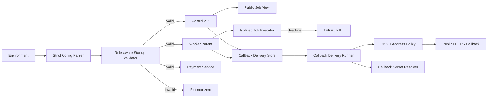
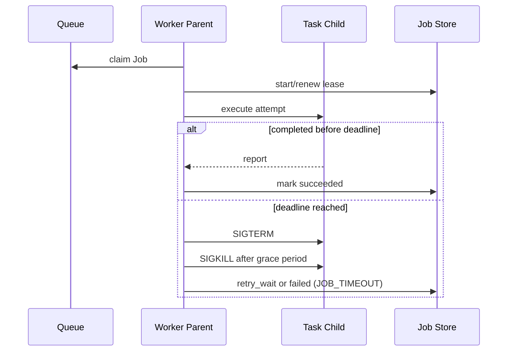

# Design Document: Production Runtime Hardening

## Overview

本设计在不重写模型优化算法和云平台主体架构的前提下，为生产入口建立 fail-closed 配置门禁，为 API key 建立严格权限边界，为 Worker 建立可终止的 deadline，并把客户 callback 从一次性 `fetch` 改造成安全、持久、可恢复的投递子系统。

设计遵循四个原则：

1. **配置错误先于流量失败**：生产错误必须在进程启动阶段被发现。
2. **内部模型不等于外部 DTO**：Secret 永不依赖调用方“不要读取”。
3. **超时必须终止工作**：只让等待者超时、底层任务继续运行不算 timeout。
4. **网络目标每次验证**：保存时合法的域名不代表投递时仍指向公网。

## Scope

| Area | Bugs | This Milestone |
|---|---|---|
| Startup/config/auth | B001, B002, B003 | Full fix |
| Worker deadline | B004 | Full fix |
| Callback safety/retry/secret | B005, B006, B007 | Full fix |
| Queue state/message atomicity | B008 | Design only; outbox deferred |
| Payment service auth | B009 | Full fix |
| Docker/docs/CI | B010 | Security and reproducibility subset |

Out of scope: GLB algorithm changes, new task types, Batch backend completion, complete supply-chain lock/checksum work, and production infrastructure mutation.

## Architecture



## Configuration Boundary

### Strict Parsing

Configuration parsing returns a result instead of silently selecting a fallback for invalid production values.

```typescript
interface ConfigIssue {
  variable: string;
  code: string;
  message: string;
  severity: 'error' | 'warning';
}

type RuntimeRole = 'api' | 'worker' | 'dispatcher' | 'monitor' | 'payment-service';

interface ConfigValidationResult {
  issues: ConfigIssue[];
  valid: boolean;
}

function validateRuntimeConfig(config: ServerConfig, role: RuntimeRole): ConfigValidationResult;
function assertRuntimeConfig(config: ServerConfig, role: RuntimeRole): void;
```

The validator runs synchronously before any port is bound or loop begins. Startup logs issue codes and variable names only. Secret values, full database URLs and parsed key definitions are never logged.

### Role Rules

| Role | Required production checks |
|---|---|
| API | valid API auth, strong Web secret, query tokens disabled, shared DB for Tencent mode |
| Worker | shared DB, valid queue/storage config, positive timeout/lease relationship |
| Dispatcher | shared DB, valid scaling backend and bounded capacity |
| Monitor | shared DB/queue and valid alarm intervals |
| payment-service | strong service key and internally consistent WeChat mode config |

`validateConfig()` may continue returning non-fatal development warnings, but production errors use a distinct `ConfigurationError` and terminate startup.

## API Key Design

### Strict Definition

```typescript
interface ApiKeyDefinition {
  name: string;
  key: string;
  scopes: string[];
  tenantIds?: string[];
  taskTypes?: string[];
}
```

Parsing rules:

- Top level must be an array.
- Every object uses an allowlist of fields.
- `name`, `key`, scopes and constraints contain non-empty strings.
- Empty scopes are rejected; wildcard must be written explicitly.
- Duplicated key material, name, scope or constraint entries are rejected.
- `tenantId` may be accepted as a compatibility alias, but not together with a conflicting `tenantIds`.
- Unknown scope names are rejected unless they use a documented extension namespace.

Authorization is an intersection, not a shortcut:

```text
allowed = endpoint_scope_matches
       AND tenant_constraint_matches
       AND task_type_constraint_matches
```

`*` only means all endpoint scopes. It does not erase tenant/task constraints. The single legacy `API_KEY` is normalized as an explicitly unrestricted legacy principal.

## Public Job View and Secret Handling

All Job responses use one serializer shared by cloud and Web account routes.

```typescript
type PublicJobView = Pick<CloudJob,
  | 'id' | 'tenantId' | 'externalJobId' | 'taskType' | 'status'
  | 'preset' | 'options' | 'attempts' | 'maxAttempts'
  | 'errorCode' | 'errorMessage'
  | 'createdAt' | 'uploadedAt' | 'queuedAt' | 'startedAt' | 'completedAt'
> & {
  callback?: { configured: boolean; secretId?: string };
};

function toPublicJobView(job: CloudJob): PublicJobView;
```

The serializer is allowlist-based so future internal fields are not exposed automatically. Result object metadata is returned only by the existing authorized result endpoint.

Production input accepts `callbackSecretId`, not `callbackSigningSecret`. `CallbackSecretResolver` initially reads a strictly parsed server-side secret map or secret-manager adapter. Jobs and deliveries store only the ID. Inline secret remains available only in explicit non-production compatibility tests and is never returned.

## Worker Deadline Design

### Parent/Child Execution Boundary

The Worker parent continues to own queue receipts, leases, heartbeats, state transitions, wallet settlement and callbacks. Actual task execution moves behind an injectable executor:

```typescript
interface JobExecutor {
  execute(input: {
    job: CloudJob;
    inputPath: string;
    outputPath: string;
    reportPath: string;
    deadlineAt: number;
  }): Promise<HeavyTaskReport>;
  terminate(reason: 'timeout' | 'shutdown'): Promise<void>;
}
```

The production executor launches a child process for a single task attempt. The child owns format conversion and `taskRegistry.run()`. This isolates synchronous CPU work and external tools from the parent event loop.

### Timeout Sequence



The deadline starts at claim, therefore download and uploads consume the same budget. External process helpers also receive an AbortSignal for prompt cancellation. The kill grace period is bounded and shorter than the lease.

On timeout the Worker stops lease renewal before releasing/retrying the message. Cleanup happens in `finally`. A timed-out child cannot access the parent store, wallet service or queue receipt.

### Attempt Ownership

This milestone must at minimum ensure a timed-out child cannot call completion code. A follow-up lease-fencing enhancement should make final transitions compare `workerId` and attempt token atomically; it is compatible with the executor boundary and should be added if implementation touches JobStore finalization.

## Callback Security Design

### Target Validation

`CallbackTargetPolicy` is used both at Job creation and immediately before each attempt.

```typescript
interface ValidatedCallbackTarget {
  url: URL;
  address: string;
  family: 4 | 6;
  servername: string;
}

interface CallbackTargetPolicy {
  validate(rawUrl: string): Promise<ValidatedCallbackTarget>;
}
```

Validation steps:

1. Parse an absolute URL and require HTTPS in production.
2. Reject username/password, fragments, malformed IDN and non-allowlisted ports.
3. Resolve A/AAAA records with a bounded timeout.
4. Classify every candidate address; reject loopback, private, carrier-grade NAT, link-local, multicast, documentation, benchmark, unspecified and metadata ranges.
5. Connect using an approved resolved address while preserving original TLS `servername` and Host header.
6. Set redirect handling to manual/error. Redirect responses are never followed.

Validating only before persistence is insufficient because DNS can change. Validating once and then allowing the HTTP library to resolve the hostname again is also insufficient because it reintroduces DNS rebinding.

### Error Surface

External errors use stable codes such as `CALLBACK_URL_INVALID`, `CALLBACK_TARGET_FORBIDDEN` and `CALLBACK_REDIRECT_FORBIDDEN`. Responses and logs may include the hostname and policy reason, but not URL credentials, query secrets or resolved secret values.

## Callback Delivery Design

### Store Contract

```typescript
interface CallbackDeliveryStore {
  createTerminalDelivery(job: CloudJob, event: CallbackEventType): Promise<CallbackDelivery>;
  claimDue(now: Date, limit: number, ownerId: string): Promise<CallbackDelivery[]>;
  markDelivered(id: string, statusCode: number): Promise<void>;
  scheduleRetry(id: string, input: RetryDeliveryInput): Promise<void>;
  markFailed(id: string, input: FailedDeliveryInput): Promise<void>;
  get(id: string): Promise<CallbackDelivery | undefined>;
  listForJob(jobId: string): Promise<CallbackDelivery[]>;
}
```

Implementations follow the existing local/MySQL/Postgres store pattern. Database migration adds a logical uniqueness constraint on `(job_id, event_type)` and claim/lease fields so multiple runners cannot deliver the same due record concurrently.

### State Machine

```text
pending -> delivering -> delivered
pending -> delivering -> retry_wait -> delivering
delivering -> failed
delivered/failed -> pending (manual replay creates audited replay attempt)
```

Retry schedule is bounded by `CALLBACK_MAX_ATTEMPTS`. Default delays follow the existing design intent (`1m, 5m, 15m, 1h, 6h, 24h`) and are capped by the configured attempt count. Network errors, timeout, 408, 429 and 5xx retry; other 4xx are terminal unless manually replayed.

Terminal Job code creates/schedules delivery and does not depend on immediate customer availability. Succeeded, failed and cancelled paths all call the same idempotent scheduling service. The runner can be hosted by the API process initially; its store lease allows later extraction to a dedicated process.

### Signature

The runner builds one JSON byte sequence, signs `timestamp + "." + rawBody`, and transmits the exact same bytes. It resolves the secret by `callbackSecretId` immediately before signing. Missing secret references fail the delivery with a sanitized configuration code rather than sending an unsigned callback unexpectedly.

## Payment Service Boundary

Payment service performs its own role-specific startup validation before binding port 3010. In production, a missing/placeholder service key is fatal. The main API validates that `PAYMENT_SERVICE_URL` and `PAYMENT_SERVICE_API_KEY` are configured together.

`requireServiceKey` no longer treats absence as disabled auth in production. It compares byte buffers with `timingSafeEqual` after a length check. `/health` remains a liveness endpoint; readiness may expose booleans such as `wechatConfigured` without returning merchant identifiers or secrets.

## Docker, Documentation and CI

### Current Milestone

- Replace root Docker `npm install` with `npm ci` against the committed lockfile.
- Do not swallow installation/verification failures for capabilities advertised by the image.
- Document `docker compose up` as lightweight API/UI only.
- Document `docker compose -f docker-compose.cloud.yml up --build` as the local async closed loop.
- Correct `/api-docs` guidance for production defaults.
- Stop treating `.env.cloud.example` as production credentials; document copy-to-local/env injection flow.
- Add CI tests for strict production config and authorization boundaries.
- Add `docker compose config` validation for default and cloud files.

### Deferred Supply-chain Work

- Pin base images by digest.
- Verify downloaded release archives with committed SHA-256 values.
- Lock Python dependency versions/hashes.
- Produce an SBOM and sign release images.

## Deferred Queue Outbox Design

`B008` requires a separate durable outbox and is not implemented as part of the callback delivery store.

```text
optimizer_delivery_outbox
id, aggregate_type, aggregate_id, event_type, payload_json
status, attempts, next_attempt_at, locked_by, lock_expires_at
created_at, published_at, updated_at
```

Job transition and outbox insert occur in one MySQL/Postgres transaction. A publisher claims due rows with locking, publishes to CMQ, and marks them complete. If publish succeeds but completion update fails, a duplicate message is acceptable because claim is idempotent. Local development may use the same table/contract or direct DB scanning, but production cannot rely on process memory.

No current-milestone change should add a `published=true` in memory or mark queued only after publish; both leave an opposite crash window.

## Error Handling

Stable production codes include:

| Code | Meaning |
|---|---|
| `CONFIG_INVALID` | One or more startup configuration errors |
| `API_KEYS_INVALID` | Structured key JSON/schema invalid |
| `API_AUTH_NOT_CONFIGURED` | Production external API has no valid key |
| `WEB_AUTH_SECRET_INSECURE` | Missing, default or weak Web signing secret |
| `INLINE_CALLBACK_SECRET_FORBIDDEN` | Production request supplied raw callback secret |
| `CALLBACK_TARGET_FORBIDDEN` | Callback violates network target policy |
| `CALLBACK_REDIRECT_FORBIDDEN` | Callback attempted redirect |
| `JOB_TIMEOUT` | Worker execution exceeded hard deadline |
| `PAYMENT_SERVICE_AUTH_REQUIRED` | Production payment service key missing |

Startup errors go to stderr/structured logger and terminate non-zero. Request errors use existing `HttpError` response shape. Callback failure details are sanitized before persistence.

## Testing Strategy

### Unit Tests

- Malformed and partially valid `API_KEYS` never disable auth.
- Wildcard endpoint scope still honors tenant/task constraints.
- Production config rejects dev secret, query tokens, local Tencent state and missing payment key.
- Public Job DTO cannot expose internal secret fields, including newly added unknown fields.
- Callback URL classification covers IPv4, IPv6, DNS results, credentials, ports and redirects.
- Retry classification, backoff, max attempts and signature bytes are deterministic.
- A fake non-returning Job executor is terminated at the configured deadline.

### Integration Tests

- Callback deliveries persist and resume after runner restart.
- Concurrent delivery runners claim one logical record.
- Timeout produces retry/final failure, scratch cleanup and wallet release behavior.
- payment-service rejects unauthenticated business calls in production mode.
- Main and payment-service startup preflight exit non-zero for invalid production fixtures.

### Static and Build Tests

- `npm run build`, `npm run lint`, `npm test`.
- payment-service build and tests.
- `docker compose config` for both Compose definitions.
- Static assertion that production Docker uses lockfile install and advertised required tools are verified.
